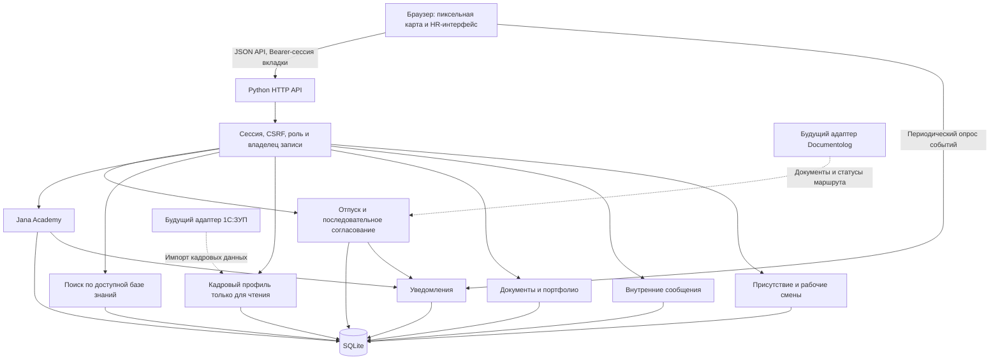

# Архитектура JanaMen

## Слои

`static/` содержит оболочку, пиксельную карту и вызовы API. `server.py` содержит HTTP-маршруты, серверную авторизацию, бизнес-правила заявок и доступ к SQLite. `academy.py` выделяет программы и назначения; `hr_assistant.py` — распознавание поддержанных вопросов и выдачу источников; `demo_data.py` — переносимое демонаполнение. При расширении адаптеры внешних систем можно добавить за текущими контрактами API.

## Модель данных

| Таблица | Назначение |
| --- | --- |
| users | Роль, подразделение, непосредственный руководитель, read-only кадровые поля, хеш пароля |
| sessions | Хеш токена сессии, пользователь, CSRF и срок действия |
| requests | Автор заявки, даты, тип, дни, статус и комментарий |
| request_history | Решения, автор действия и время |
| notifications | Владелец, прочтение, тип события и ссылка на объект |
| courses | Материалы курса и тест с правильными ответами на сервере |
| enrollments | Назначение, прочитанные разделы, результат и завершение |
| knowledge | Подготовленный текст, раздел, ключевые слова и разрешённые роли |
| login_attempts | Ограничение частоты неуспешного входа |
| requests.approval_route / stage_index | JSON-маршрут и текущий этап; история решений — в request_history |
| employee_documents | Закрытые PDF/DOCX/PNG/JPG и метаданные портфолио |
| direct_messages | Внутренние диалоги и отметка прочтения |
| work_shifts | Начало, завершение, работа и перерывы |
| presence / session_activity | Текущий статус и присутствие активной вкладки |
| video_progress / xp_awards | Просмотр видео, результаты тестов, XP и уровни |

## Границы доступа

Работник получает только свои заявки, назначения, документы и уведомления. Руководитель дополнительно получает непосредственную команду и её разрешённые документы. HR получает разрешённые кадровые записи компании и может назначать курсы. Проверки выполняются на API до выдачи данных и до изменения записи. Собственную заявку нельзя согласовать даже HR или директору. Правильные ответы теста API не выдаёт. Официальные кадровые поля не имеют маршрута редактирования.

Создание и согласование заявки выполняются в транзакции. Повторное решение и пропуск этапа блокируются. Ежегодные дни уменьшаются один раз после финального согласования. Заявка, история и уведомление сохраняются вместе. Возврат на доработку сохраняет историю и после повторной отправки запускает маршрут заново.

## Будущая интеграция 1С:ЗУП

В текущей версии роль источника кадровых данных выполняет тестовая таблица `users`. На её границе нужен адаптер импорта: внешний идентификатор работника, Ф.И.О., компания, должность, подразделение, руководитель, дата приёма и актуальный остаток. Плановый импорт или webhook обновляет серверное хранилище. Пользователь не получает доступ к 1С и не меняет её поля напрямую. Необходимо предусмотреть дату синхронизации, ошибки и согласованную политику расчёта отпусков. Внешние идентификаторы и реальный адаптер пока не реализованы.

## Будущая интеграция Documentolog

Точка подключения — создание заявки и изменение её статуса. Адаптер создаёт внешний маршрут, сохраняет ID документа, принимает проверенный callback и переводит внешний статус во внутренний. Для промышленной версии понадобятся idempotency key, проверка подлинности callback, повторные попытки и журнал обмена. В MVP маршрут исполняется локально без электронных подписей и хранения оригиналов.

## HR-ассистент

Сервер проверяет сессию, затем `hr_assistant.py` сопоставляет **весь** вопрос с поддержанными формулировками. Совпадение общего слова не является основанием для ответа. Проверенная статья возвращается дословно только после проверки её `roles`; API открытия источника повторяет эту проверку. Для личных данных используются только записи текущего пользователя, а источник ведёт в соответствующий раздел. Ответы не генерируются внешней LLM.

Неподдержанные правила, дополнительные неизвестные условия и запросы вне базы возвращают явное отсутствие надёжного ответа и контакт HR. Кнопка открывает внутренний чат и не отправляет сообщения сама. Ассистент может подготовить отдельное сообщение только по явной команде; отправка требует подтверждения. Ограничение MVP: некоторые перефразировки потребуют уточнения. В будущем возможен семантический поиск по разрешённым фрагментам с порогом релевантности и проверкой цитат.

## Эксплуатационные ограничения

SQLite и встроенный HTTP-сервер подходят для локальной хакатонной демонстрации. Публичные демо-аккаунты, отсутствие HTTPS и промышленной инфраструктуры требуют отдельной подготовки перед реальным внедрением. Docker подготовлен для воспроизводимого локального запуска, а не заявлен как проверенное промышленное развёртывание.

## Состояние офиса

Таблица `presence` хранит выбранный пользователем статус, исходную и целевую комнаты, время отправления и прибытия, накопленную длительность работы и перерывов. `GET/POST /api/presence` работает только с текущим аккаунтом. `GET /api/office-team` доступен руководителю для непосредственной команды и HR для разрешённых сотрудников. Произвольный `user_id` не позволяет менять другого человека.

Браузер интерполирует путь между комнатами по серверным временным меткам. Живая карта обновляется примерно каждые 1,5 секунды, heartbeat активной вкладки — каждые 20 секунд. Декоративные NPC существуют только в интерфейсе и не участвуют в кадровых данных.

Таблица `office_seats` закрепляет уникальный `seat_key` за каждым аккаунтом. Клиент не может подменить место через API статуса. Клиентский модуль `office.js` хранит координаты столов и путевые точки коридоров, а сервер возвращает закреплённый ключ вместе со статусом. Кадры приветствия и ракурса со спины хранятся в локальном спрайт-листе.

### Дополнение: медиа, документы и учебный опыт
Видеофайлы хранятся в static/assets и передаются с поддержкой Range (206). Приватные документы хранятся отдельно в таблице employee_documents (BLOB) и выдаются только через аутентифицированный API с RBAC и Content-Disposition: attachment. Каталог /api/directory возвращает минимальную рабочую карточку; запрос документов проверяет владельца, непосредственного руководителя или HR.
video_progress хранит подтверждённый просмотр; API сравнивает перемещение позиции с прошедшим временем. Это защита от обычной перемотки, не доказательство внимания человека. Курс завершается только при достаточном просмотре и успешном тесте. xp_awards имеет составной первичный ключ (user_id, course_id), поэтому награда за курс уникальна. Оценка и награда записываются одной транзакцией. При перезапуске сохраняются прогресс, документы и баллы.

## Jana Academy: программы и назначения

`academy.py` отвечает за программы по должности и HR-назначения внутри существующей Академии. SQLite хранит `academy_assignments`, получателей `academy_recipients` и закрытые вложения `academy_files`. Файлы выдаются через `/api/academy/files/:id` с проверкой сессии и назначения. Материалы чужих персональных папок недоступны обычным сотрудникам и руководителям. HR загружает новый видеокурс с тестом или назначает готовый курс отдельному сотруднику, должности либо подразделению.

`learning_steps` имеет уникальный ключ `(user_id, course_id, kind)`: просмотр и тест дают отдельные, неповторяемые награды. При провале теста сбрасываются просмотр и пройденные разделы, но существующие награды не удаляются. Сервер ограничивает учебный уровень десятью. Завершение обучения создаёт уведомление только самому учащемуся, с переходом к курсу и результату. Для руководителей и HR событий о чужом завершении нет. Условное обновление `completed_at IS NULL`, начисление награды и запись уведомления выполняются в одной транзакции: повторная и одновременная отправка результата не дублируют награду или событие. Прогресс можно проверить в карточках сотрудников и списке назначений.

Должность и подразделение сейчас берутся из локального справочника; будущий адаптер 1С:ЗУП должен обновлять эти поля, на основе которых HR выбирает аудиторию обучения. Интеграция с Documentolog остаётся на стороне кадровых заявок и документов.

## Переносимый запуск и демонстрационные данные

Обычный CLI-запуск и Docker используют одинаковую инициализацию: схема → миграции → `demo_data.seed`. PDF-примеры включены в `content/showcase/`; дополнительные DOCX создаются стандартной библиотекой. Пакеты для генерации видео и шрифты macOS не нужны для запуска сайта или заполнения базы. Маркеры миграций защищают пользовательские записи от повторного импорта. Флаг `--minimal-demo` позволяет на новой базе запустить только минимальные примеры. Тесты не используют рабочую базу.

## История сообщений и доставка

`content/demo_messages.json` содержит 13 вымышленных диалогов. `demo_data.seed_conversations` импортирует их в одной транзакции с отдельным маркером миграции: повторный запуск не добавляет дубликаты и не меняет существующие сообщения. Демосообщения датированы прошлым и прочитаны, поэтому не создают уведомлений о новых входящих.

Новые сообщения сохраняются вместе с уведомлением адресату. API выбирает диалог только по текущему пользователю и собеседнику; даже HR не получает чужую переписку. Контакты сортируются по времени последнего сообщения, история выдаёт последние 300 записей в хронологическом порядке. Открытие диалога помечает входящие сообщения и соответствующие уведомления прочитанными. Индикаторы и открытый чат обновляются периодическим опросом; это не push-доставка.

## Автоматический перерыв и текущая длительность

Клиент отправляет `/api/activity` только после реального движения указателя, нажатия, прокрутки или касания внутри страницы, не чаще одного раза в пять секунд. Heartbeat и фоновые запросы не считаются действиями пользователя. Аккаунт определяется по сессии вкладки; события одного человека не меняют другого. Таблица `office_activity` хранит время последнего действия, начало текущего режима и признак автоматического перерыва.

Сервер проверяет таймер каждую секунду и при чтении присутствия. Через 120 секунд переводит сотрудника из работы в `break/lounge`, начисляя рабочее время до порога, затем время перерыва. Реальное действие возвращает сотрудника к столу; если аватар ещё идёт, он сначала завершает переход. Ручной перерыв требует ручного продолжения, завершённая смена не запускается движением мыши. Учёт активности не является доказательством производительности и ограничен страницей приложения.

`GET /api/people/:id/presence` выдаёт текущую длительность и итоги смены только самому сотруднику, его непосредственному руководителю и HR. Карточка обновляет счётчик каждую секунду, сверяет статус с сервером каждые три секунды. Общая карта не получает чужие суммарные таймеры.

Таймер над аватаром использует отдельный `GET /api/people/:id/map-presence`: роль руководителя/HR обязательна, затем проверяется принадлежность к команде. Обычный сотрудник не может получить его даже для себя. Клик руководителя/HR показывает окно над аватаром; профиль открывается отдельной кнопкой в этом окне. Счётчик обновляется раз в секунду, статус — каждые три секунды. При закрытии, смене аккаунта или удалении аватара опрос прекращается.

Для пяти вымышленных NPC (`*.demo`) `demo_npc_presence` рассчитывает состояние и длительность по общему серверному времени. Та же модель используется для расположения аватара и закрытых таймеров в карте/карточке коллеги. Синтетические итоги не записываются в реальные смены. Вход в настоящий аккаунт NPC отключает его демонстрационное состояние. Алина, Санжар, Аружан и остальные аккаунты для входа используют фактические события платформы.

## Назначение рабочих задач

`tasks.py` хранит задачи в `employee_tasks`, а закрытые файлы назначения и результата — в `task_files`. `GET/POST /api/tasks`, `GET/POST /api/tasks/:id`, `POST /api/tasks/:id/submit` и `GET /api/tasks/:id/files/:fileId` используют общую сессию и CSRF. Сервер определяет автора и исполнителя; обычный сотрудник не может назначать задачи. Руководитель назначает только непосредственной команде, HR — сотрудникам компании. Черновик читает и изменяет только автор; после отправки доступны участники, HR и непосредственный руководитель исполнителя.

Черновик редактируется с проверкой версии. Отправка, смена статуса, файл и уведомление сохраняются в одной транзакции; повторная/одновременная отправка блокируется. Просрочка вычисляется из дедлайна и не требует фонового изменения БД. Исполнитель может отправить результат и после срока. Завершение по отправке результата — выбранный сценарий MVP, дополнительного этапа приёмки нет.

Даты нормализуются на сервере и хранятся как Unix timestamp; интерфейс показывает местное время браузера. Примеры заданий и черновиков создаются идемпотентно при штатном запуске, без перезаписи пользовательских задач и без уведомлений от старого демонаполнения.
