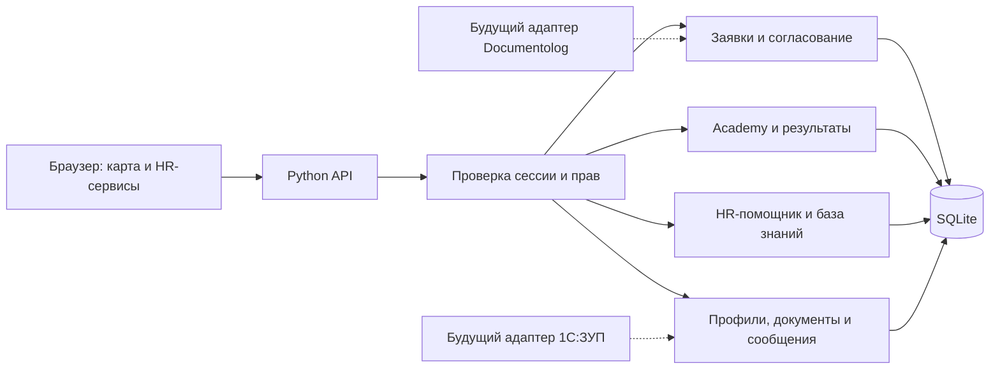

# JanaMen — единая Digital HR-платформа

Хакатонный MVP для кейса Jana Post. JanaMen объединяет профиль сотрудника, HR-заявки, обучение, документы, уведомления и HR-помощника в одном веб-приложении.

Главная особенность интерфейса — живая пиксельная карта офиса. У каждого сотрудника свой аватар и закреплённое рабочее место. Начало дня, перерыв и возвращение к работе отображаются на карте. Основные сервисы также доступны через боковое меню.

## Соответствие заданию и состав сдачи

**Проблема:** сотрудник ищет кадровые сведения, оформляет заявки и проходит обучение в разных системах. HR и руководитель вручную координируют действия и отвечают на повторяющиеся вопросы.

**Решение:** единый личный кабинет с общими данными, ролевым доступом и связанными событиями. Заявка проходит согласование, решение появляется в истории и уведомлениях сотрудника. Результат обучения сохраняется в его профиле. Пиксельная карта объединяет сервисы в узнаваемое рабочее пространство, а боковое меню даёт прямой доступ к каждому разделу.

| Что требуется сдать | Где находится / как проверить |
| --- | --- |
| Работающий веб-прототип / MVP | Запустить `server.py` по инструкции ниже и открыть локальный адрес |
| Исходный код в репозитории | `server.py`, `static/`, `content/`, `scripts/` и тесты в этом репозитории |
| README с запуском, тестовыми аккаунтами и сценариями | Разделы «Быстрый запуск», «Демо-аккаунты» и «Сценарий проверки прототипа» |
| Схема архитектуры с будущими интеграциями | Схема ниже и отдельный файл [ARCHITECTURE.md](ARCHITECTURE.md): точки подключения 1С:ЗУП и Documentolog |
| Короткая презентация и демонстрация | Презентация передаётся отдельно. Сквозной сценарий для живого показа описан ниже |

README описывает решение и способ его проверки. Презентация и работающий запуск являются отдельными частями сдачи.

## Быстрый запуск

Требуется **Python 3.10 или новее**. Для запуска приложения сторонние Python-библиотеки не нужны.

1. Скачайте репозиторий: **Code → Download ZIP** и распакуйте архив.
2. Откройте терминал в папке, где находится `server.py`.
3. Выполните:

```bash
python3 server.py
```

На Windows можно использовать `py server.py`.

4. Откройте **http://127.0.0.1:8765/** в браузере.

Не открывайте `static/index.html` напрямую: сайту нужен работающий API-сервер. Для остановки нажмите `Ctrl+C` в терминале.

При первом запуске создаётся база `data/janamen.sqlite3` с базовыми тестовыми данными. Изменения сохраняются между запусками.

Другой порт:

```bash
python3 server.py --port 8780
```

Для демонстрации на телефоне в той же Wi-Fi-сети:

```bash
python3 server.py --host 0.0.0.0 --port 8765
```

На телефоне откройте `http://IP-адрес-ноутбука:8765/`. Сам ноутбук должен оставаться включённым, а сервер — запущенным.

Docker — дополнительный вариант запуска:

```bash
docker compose up --build
```

Docker-конфигурация включена в проект, но её сборка в среде разработки не проверялась.

## Демо-аккаунты

Все аккаунты вымышленные. Указанные пароли намеренно опубликованы для проверки прототипа и не являются корпоративными учётными данными.

| Пользователь | Логин | Демо-пароль | Назначение |
| --- | --- | --- | --- |
| Алина Петрова | `employee` | `AlinaDemo!2026` | Сотрудник |
| Санжар Ким | `manager` | `SanzharDemo!2026` | Руководитель |
| Аружан Бекенова | `hr` | `HRDemo!2026` | HR / администратор |
| Тимур Садык | `colleague` | `TimurDemo!2026` | Сотрудник другого подразделения |
| Ерлан Аскаров | `director` | `DirectorDemo!2026` | Директор, согласующий |
| Дана Сейтова | `hr2` | `HR2Demo!2026` | Второй HR, замещение |

В системе три технические роли: сотрудник, руководитель и HR. Директор использует роль руководителя, второй HR — роль HR.

Разные аккаунты можно открыть в обычных вкладках одного браузера. Сессия веб-клиента хранится отдельно в памяти каждой вкладки. После перезагрузки страницы нужно войти снова.

## Реализованные возможности

- **Авторизация и права:** серверная проверка роли и владельца данных, защита от самосогласования, CSRF-защита, ограничение попыток входа, PBKDF2-хеширование паролей.
- **Личный кабинет:** кадровые сведения, подразделение, должность, руководитель, дата приёма, остаток отпуска, обучение и история смен. Официальные кадровые поля доступны только для чтения.
- **HR-сервисы и мои заявки:** оформление отпуска, единый список заявок, статусы, история решений, возврат на доработку и повторная отправка.
- **Последовательное согласование:** решение руководителя, затем HR. Финальное уведомление приходит после завершения маршрута. Согласование собственных заявок запрещено.
- **Виды отпуска:** ежегодный оплачиваемый, без сохранения заработной платы, учебный и социальный. Руководитель и HR также могут подавать заявки.
- **Уведомления:** события заявок, обучения и внутренних сообщений, счётчик непрочитанных и переход к связанному объекту.
- **Jana Academy:** учебные материалы и два видеоурока по 5 минут 45 секунд, сохранение прогресса, тесты по 10 вопросов, результат, XP, значки и учебные уровни.
- **Документы и портфолио:** загрузка PDF, DOCX, PNG и JPG, скачивание с проверкой доступа. Сотрудник видит свои документы, руководитель — разрешённые документы команды, HR — разрешённые записи компании.
- **HR-помощник:** ответы по подготовленной базе знаний с источником, работа с доступными данными аккаунта, отказ при отсутствии надёжного ответа. Подготовленное помощником внутреннее сообщение отправляется после подтверждения.
- **Коллеги и сообщения:** рабочие карточки сотрудников и внутренние личные диалоги.
- **Пиксельный офис:** анимация входа, перемещение к личному столу и на перерыв, синхронизация присутствия, настройка внешности аватара.
- **Рабочее время:** учёт выбранных статусов работы и перерыва, сохранение завершённых смен.
- **RU/KZ:** переключение основных элементов интерфейса и подписей карты. Полная локализация учебных материалов и базы знаний остаётся дальнейшей задачей.

## Маршруты отпусков

| Автор | Первый согласующий | Второй согласующий |
| --- | --- | --- |
| Алина и сотрудники команды Санжара | Санжар | Аружан |
| Санжар | Ерлан | Аружан |
| Аружан | Ерлан | Дана |
| Дана | Ерлан | Аружан |
| Ерлан | Санжар | Аружан |

Маршрут сохраняется в заявке. Решение может принять только текущий согласующий. Возврат на доработку сохраняет историю; повторная отправка запускает согласование заново. Это демонстрационная конфигурация замещения.

## Сценарий проверки прототипа

1. Откройте три вкладки и войдите как `employee`, `manager` и `hr`.
2. От лица Алины нажмите «Начать работу»: аватар проходит от входа к своему месту.
3. В HR-сервисах создайте заявку на отпуск с будущими датами без пересечения с существующими заявками.
4. От лица Санжара найдите заявку и согласуйте её.
5. От лица Аружан выполните финальное согласование.
6. Вернитесь к Алине и откройте уведомление, итоговый статус и историю заявки.
7. Откройте Academy, посмотрите материал и проверьте сохранение прогресса. Для видеокурса тест доступен после просмотра не менее 90%; проходной балл — 70%.
8. Спросите помощника «Как оформить отпуск?» и откройте источник. Затем задайте вопрос вне базы: помощник должен сообщить об отсутствии надёжной информации.
9. Загрузите документ от лица Алины и проверьте доступ руководителя. Обычный сотрудник не должен получать чужие приватные документы.

Для короткой защиты курс стоит подготовить заранее: прохождение пятиминутного видео и десяти вопросов не помещается в двухминутную демонстрацию.

## Что должен увидеть проверяющий

| Требование кейса | Действие | Ожидаемый результат |
| --- | --- | --- |
| Единый вход и ролевой доступ | Войти сотрудником, руководителем и HR в разных вкладках | У каждого аккаунта собственная сессия и разрешённые действия; права проверяет API |
| Личный кабинет | Открыть профиль Алины | Кадровые сведения, остаток отпуска и результаты обучения доступны в одном месте |
| Сквозной HR-сценарий | Алина подаёт отпуск → Санжар согласует → Аружан согласует | Заявка последовательно проходит два этапа, Алина получает итоговое уведомление |
| Статус и история | Открыть карточку заявки у Алины | Видны текущий статус, участники и история решений |
| Ролевая модель | Попробовать получить документы другого сотрудника без полномочий | Сервер отказывает в доступе; скрытия кнопок в интерфейсе недостаточно |
| Jana Academy | Пройти материал и успешно завершить тест | Сохраняются прогресс, оценка и завершение; начисляется учебный XP |
| HR-ассистент: источник | Задать «Как оформить отпуск?» | Ответ по подготовленной базе со ссылкой на источник |
| HR-ассистент: неизвестный вопрос | Задать вопрос вне базы знаний | Помощник сообщает об отсутствии надёжной информации |
| HR-ассистент: приватность | Запросить чужие конфиденциальные сведения | Помощник не раскрывает недоступные текущему пользователю данные |
| Будущие интеграции | Открыть архитектурную схему | Понятны источник кадровых данных 1С:ЗУП и точка обмена маршрутами с Documentolog |

## Короткая демонстрация на защите

Регламент: **1 минута питча и 2 минуты показа**, затем вопросы жюри. Перед показом открыть три вкладки с Алиной, Санжаром и Аружан, подготовить свободные будущие даты отпуска и пример учебного результата.

| Время показа | Действие |
| --- | --- |
| 0:00–0:25 | Показать офис Алины, открыть HR-сервисы и отправить заявку |
| 0:25–0:45 | Перейти к Санжару и выполнить первое согласование |
| 0:45–1:05 | Перейти к Аружан и выполнить финальное согласование |
| 1:05–1:25 | У Алины показать уведомление, итоговый статус и историю |
| 1:25–1:40 | В Academy показать видео, тест и сохранённый учебный результат |
| 1:40–2:00 | Показать ответ помощника с источником и отказ на вопрос вне базы |

Это план репетиции, а не измеренная скорость выполнения. Для полного прохождения обучения используется отдельный сценарий проверки выше.

## Архитектура и стек

**Интерфейс:** HTML, CSS, JavaScript, локальные изображения, спрайты и шрифты.  
**Сервер:** Python, стандартная библиотека, JSON API.  
**Хранилище:** SQLite.



Подробности — в [ARCHITECTURE.md](ARCHITECTURE.md).

Будущий адаптер **1С:ЗУП** должен импортировать кадровые сведения и остатки отпусков. Адаптер **Documentolog** должен передавать заявки и получать статусы внешнего маршрута. Реальные соединения с этими системами в MVP не реализованы.

## Структура проекта

```text
server.py                 HTTP API, авторизация, бизнес-правила и SQLite
static/                   Интерфейс, карта, аватары и клиентские модули
static/assets/            Изображения, шрифт, видео и субтитры
content/academy.json      Сценарии видеоуроков и тесты
content/showcase/         Вымышленные PDF-примеры портфолио
scripts/build_academy.py  Генератор учебных видео
scripts/seed_showcase.py  Дополнительное демонстрационное наполнение
test_*.py                 API-тесты
test_frontend.cjs         Проверки клиентских обработчиков
ARCHITECTURE.md            Архитектура и будущие интеграции
ASSETS.md                 Происхождение визуальных ресурсов
Dockerfile / compose.yaml Дополнительный способ запуска
data/                     Локальная база; не включается в репозиторий
```

## Проверки

Из папки с `server.py`:

```bash
python3 -m unittest -v test_mvp.py test_features.py test_leave.py test_live.py
node test_frontend.cjs
```

Для второй команды требуется Node.js; для работы самого сайта Node.js не нужен. Тесты используют временную базу и не изменяют рабочую демонстрацию.

Последняя выполненная проверка: **28 API-тестов прошли**, frontend smoke-test прошёл. Проверены права, приватность документов, согласование отпусков, обучение, XP, сообщения, смены и независимость вкладок. Эти проверки не заменяют визуальную проверку в браузере.

## Демонстрационные данные и материалы

Все сотрудники, кадровые записи и регламенты вымышленные. Реальные персональные данные Jana Post не используются.

Базовые аккаунты и данные создаются автоматически. Расширенное наполнение с портфолио, историей отпусков и учебными результатами добавляется отдельно:

```bash
python3 -m pip install reportlab
python3 scripts/seed_showcase.py
```

Этот вспомогательный скрипт использует системный Arial по пути macOS `/System/Library/Fonts/Supplemental/Arial.ttf`. На другой ОС перед запуском нужно настроить путь к подходящему шрифту. Повторное наполнение защищено маркером миграции. Наличие PDF в `content/showcase/` само по себе не импортирует их в новую базу.

Готовые видео включены в проект. Их повторная генерация не нужна для запуска. Генератор использует Pillow, edge-tts и imageio-ffmpeg; озвучка синтетическая. Учебные материалы не являются официальными регламентами Jana Post.

## Границы MVP

- HR-помощник использует детерминированный поиск и обработку тем запроса. Внешняя LLM и полноценный семантический RAG не подключены.
- Отпуск рассчитывается по демонстрационным календарным правилам без производственного календаря. Учебный, социальный и неоплачиваемый отпуск не расходуют ежегодный баланс в модели прототипа.
- XP отражает учебный прогресс и не принимает кадровых решений о повышении.
- Присутствие и уведомления обновляются опросом сервера. Это не push-доставка и не мониторинг устройства сотрудника.
- Электронная подпись, оригиналы кадровых документов, промышленный SSO и реальные интеграции находятся за рамками MVP.
- Встроенный HTTP-сервер и публичные демо-аккаунты предназначены для демонстрации. Реальное внедрение требует отдельной инфраструктуры, HTTPS и корпоративной авторизации.

GitHub хранит исходный код проекта. Для работы приложения нужен Python-сервер; статического размещения файлов на GitHub Pages недостаточно.

## Использованные инструменты

HTML, CSS, JavaScript, Python, SQLite, Git; Docker-конфигурация для альтернативного запуска. При разработке и подготовке материалов использовались Codex / ChatGPT, ImageGen для пиксельных ресурсов и Edge TTS для синтетической озвучки. Шрифт Tiny5 поставляется с лицензией OFL. Подробности ресурсов — в [ASSETS.md](ASSETS.md).
